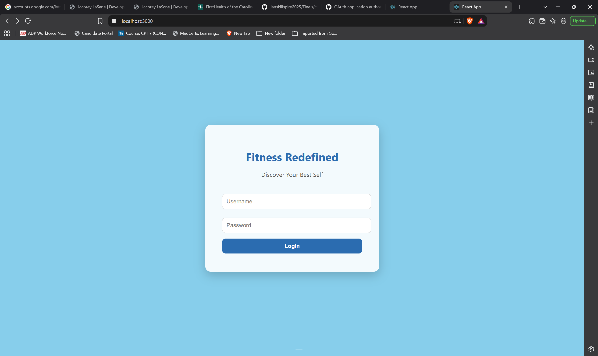
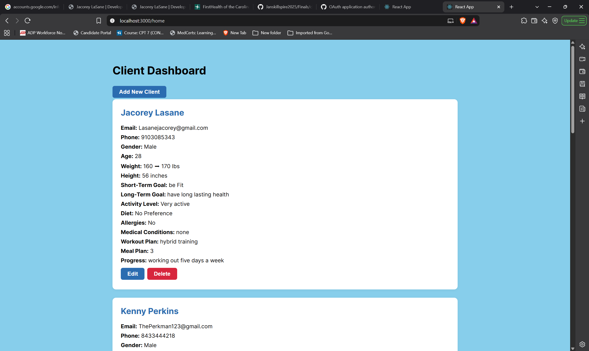
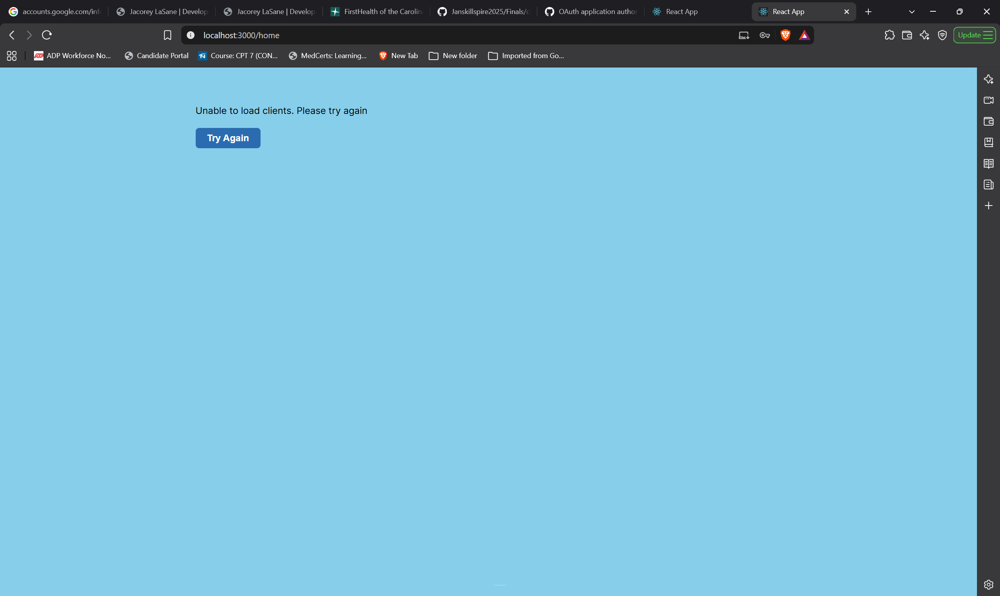

# Fitness Redefined

A personal training client management app built with React, Flask, and SQLite.

Fitness Redefined helps trainers organize client profiles, fitness goals, workout plans, meal plans, and progress notes.

**Status:** Working prototype for learning and portfolio demonstration.

## Features

- Add, view, edit, and delete client profiles.
- Record current and target weight in pounds.
- Record height in inches.
- Maintain short-term and long-term fitness goals.
- Record activity levels and dietary preferences.
- Maintain workout plans, meal plans, and progress notes.
- Return to the dashboard after adding, editing, or deleting a client.
- Display a helpful message and retry button when clients cannot load.

## Technology

| Layer | Technology |
|---|---|
| Frontend | React, JavaScript, CSS |
| Navigation | React Router |
| API requests | Axios |
| Backend | Python, Flask |
| Database | SQLite with Flask-SQLAlchemy |
| Cross-origin requests | Flask-CORS |

## Project Structure

This README is located inside the client folder.

- `client/` — React application
- `client/src/components/` — Login, dashboard, and client forms
- `client/src/API/api.js` — Backend API calls
- `server/app.py` — Flask application and database model
- `server/instance/` — Local SQLite database

## Run Locally

Install Python and Node.js with npm before starting.

Run the following commands from the `Finals` folder using two separate terminals.

### 1. Start the backend

```powershell
cd server
py -m pip install flask flask-sqlalchemy flask-cors
py app.py
```

The backend runs at http://localhost:5002.

The app creates the database tables if they do not already exist.

### 2. Start the frontend

In a second terminal, starting from the `Finals` folder:

```powershell
cd client
npm.cmd install
npm.cmd start
```

Open http://localhost:3000.

Keep both terminals running while using the app.

## Demo Login

| Field | Value |
|---|---|
| Username | trainer |
| Password | fit123 |

The login uses hardcoded frontend credentials. It is a demonstration screen and does not provide backend authentication or protect client records.

Use fictional client information when demonstrating the project.

## Manual Verification

The following workflows were checked during development:

- Adding a client and viewing the new profile.
- Editing a client and confirming changes after refresh.
- Deleting a client through the confirmation screen.
- Returning to Home after adding, editing, and deleting.
- Displaying an error message when the backend is stopped.
- Reloading clients with Try Again after restarting the backend.

## Current Limitations

- Progress is stored as notes rather than dated tracking entries.
- Workout and meal plans are entered manually.
- Authentication and access control are not implemented.
- Dependencies have reported audit findings that still require review.
- This prototype is not ready for use with real client information.

## Planned Improvements

- Dated weight and progress entries.
- Progress charts.
- Stronger form validation.
- Consistent error handling across all client forms.
- Backend authentication and protected API routes.
- Dependency updates and deployment preparation.


## Screenshots

### Demo Login


### Client Dashboard


### Connection Error Handling


## Developer

Jacorey Lasane
